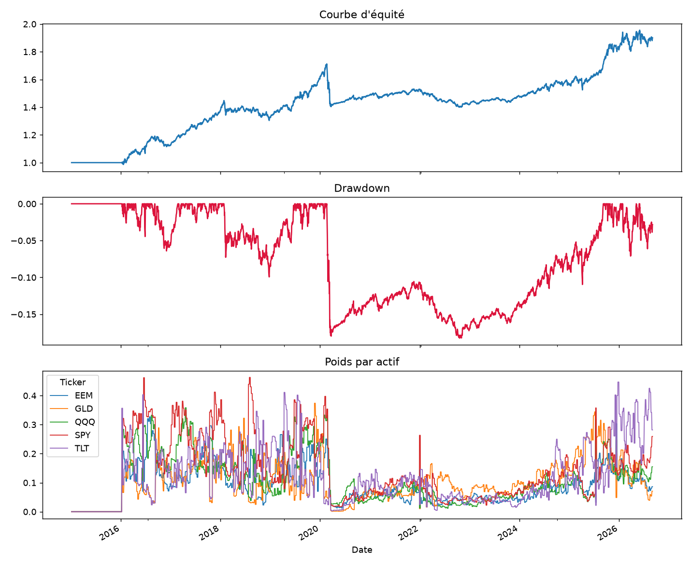

# Strategy Backtesting & Portfolio Construction Pipeline

> From "one signal per asset" to a **risk-managed multi-asset portfolio**: risk-parity allocation, fractional Kelly sizing, VaR budgeting, drawdown throttling, and a **causal (no look-ahead) walk-forward backtest** with transaction costs.

  



---

## Project Overview

| | |
|---|---|
| **Problem** | A trading signal alone is not a strategy. Capital must be allocated across assets, risk must be bounded, and the backtest must not cheat by peeking at future data. |
| **Solution** | A modular Python pipeline: data → signals → risk estimation → position sizing → portfolio constraints → walk-forward backtest. |
| **Key engineering choice** | Weights decided at day *t* only earn the return of day *t+1*, which removes look-ahead bias, the most common reason backtests look "too good". |
| **Skills shown** | Quantitative portfolio theory, risk management (VaR / CVaR / drawdown), numerical methods, clean modular design, input validation (Pydantic), unit testing. |

---

## Architecture

```
data.py        Multi-asset price download (yfinance)
signals.py     Per-asset alphas (momentum + mean-reversion) + walk-forward adapter
risk.py        Historical & parametric VaR, CVaR, drawdown
sizing.py      Risk parity (iterative), multi-asset Kelly, drawdown throttle
portfolio.py   Combines sizing + VaR budget + drawdown throttle into target weights
backtest.py    Causal walk-forward loop: periodic rebalancing, transaction costs, equity curve
main.py        End-to-end run with charts
test_core.py   Unit tests on the core logic
```

Data flow: `prices -> signals -> covariance & risk -> sizing -> constraints -> weights(t) -> return(t+1) -> equity curve`

---

## The three theoretical building blocks

### 1. Risk parity
Instead of weighting assets by expected return (which is notoriously hard to estimate), weights are chosen so that **every asset contributes an equal share of total portfolio risk**. Solved with a simple iterative algorithm, so no external optimizer is needed (`sizing.risk_parity_weights(cov)`).

### 2. Kelly criterion (multi-asset, fractional)
The growth-optimal allocation is `f* = Σ⁻¹ μ` (Σ: covariance matrix, μ: expected returns). Full Kelly is aggressive and extremely sensitive to errors in μ, so the pipeline uses **half-Kelly** (`kelly_fraction = 0.5`) together with a **gross leverage cap** (`gross_leverage_cap`).

### 3. Hard risk constraints
- **VaR budget**: if the portfolio's parametric VaR exceeds `var_budget`, all weights are scaled down proportionally (forward-looking control).
- **Drawdown throttle**: gross exposure is reduced linearly as the current drawdown approaches `dd_limit`, down to a floor `dd_min_exposure` (reactive control that complements the VaR).

---

## Why the backtest is trustworthy

- **Causal by construction**: weights computed with information available at day *t* are applied to the return of day *t+1* only (main loop of `backtest.py`).
- **Walk-forward**: `run_walk_forward_backtest()` expects a callable `alpha_predict_func(expanding_prices) -> Series`, so the signal only ever sees data up to the rebalancing date.
- **Transaction costs** are charged at each rebalance.
- **Typed configuration**: `PortfolioConfig` is a Pydantic model, so parameter bounds are validated and the config serializes straight to JSON (ready for an API or a UI).

Outputs: performance `metrics`, `equity_curve`, and `weights_history`.

---

## Quick start

```bash
pip install yfinance pandas numpy scipy matplotlib pydantic
python main.py
```

Plug in your own model: write a function with the signature `alpha_predict_func(expanding_prices) -> pd.Series` (one score per asset) and pass it to `run_walk_forward_backtest()`. A vectorized signal can be wrapped with `signals.make_walk_forward_predictor(...)`.

---

## Known limitations and next steps

- The alphas in `signals.py` are deliberately simple (demo purpose); the design is meant to receive a real ML model.
- Covariance uses a simple rolling window. Natural upgrades: Ledoit-Wolf shrinkage, EWMA, factor models.
- Kelly uses the alpha score as a proxy for μ. A cleaner approach calibrates μ separately (e.g. score × historical volatility).
- No multi-currency handling and no financing cost for leverage.

---

## Skills

**Quant finance**: risk parity, Kelly criterion, VaR / CVaR, drawdown control, walk-forward validation, look-ahead bias prevention
**Python**: NumPy, pandas, SciPy, Matplotlib, Pydantic, modular package design, unit tests
**Engineering mindset**: reproducible pipeline, explicit assumptions, documented limitations

---

## Related project

Designed to plug into my FastAPI + React trading [Dashboard](https://github.com/Thanh-Poth/Dashboard) (the backtest function can sit behind a `POST /portfolio/backtest` endpoint).

## Author

**Thanh Son Potherat**: engineering student focused on quantitative finance, machine learning and data science.
[GitHub](https://github.com/Thanh-Poth) | [LinkedIn](https://www.linkedin.com/in/thanh-son-potherat-b793b333a/)
